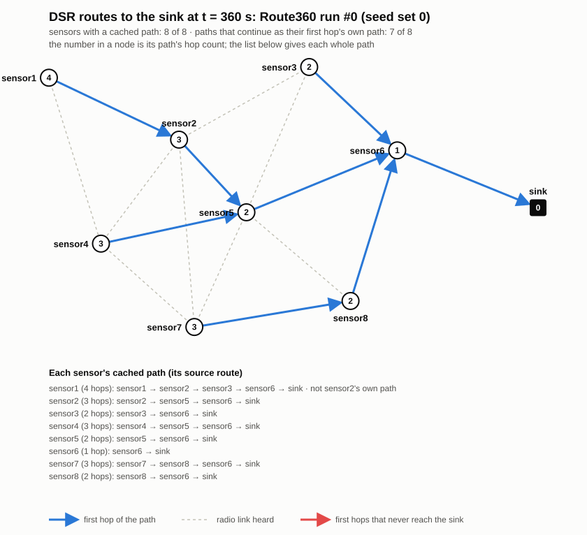

# Case study: DSR

Dynamic Source Routing puts the whole route in the packet. A route request (RREQ) collects the
path it travels; the destination returns a route reply (RREP) carrying that path; the originator
caches the full path and later sends each data packet along it. This case study runs the
generated structure 4 as a DSR node for the discovery half: the request flood and the reply along
the reversed path.

**What is known about DSR here is thin, and the page says so first.** No DSR Event-B model exists
beyond an abstract first machine, no DSR code exists in the project, and INET 4.5 has no DSR. The
only code-level source is the Final Report's printed fragment of MiXiM's `DSRRoute` (its Figures
6.8 to 6.12). The checks below therefore carry more weight than the baseline comparison.

**Baseline:** `DSRRoute`, an INET network protocol written for this project, shaped on that
printed code. It is not independent (see below).

## Input

The same pattern project as the MintRoute case study (not published; see
[About](../about.md#availability)), with the DSR split of the control packet type: the same
`RREQ`, `RREP` and `RRER` types as AODV's, in its own context file, with the RREQ transmit named
`sendRREQ` after the Final Report.

```bash
npm run generate -- <pattern project> out --v4 --routing dsr
```

## Generated and pasted

| Generated | Pasted (`[DSR test code]`, switched by `dsr = true`) |
|---|---|
| `RreqPkt`, `RrepPkt` and `RrerPkt` packet classes | `DsrRreqPkt` and `DsrRrepPkt`, extending them with the route record |
| the RREQ flood, with duplicate suppression, and the transmit named `sendRREQ` | the route record: the originator first, each forwarder appended, 4 bytes per entry on the air |
| one timer per packet type; the neighbour table and its counters | the sink's RREP along the reversed record, taken at the arrival before the model |
| the route-table operation `addEntry` and route publication into INET's table | `reverseRoute`, `updateRouteCacheTable`, `selectRoute` and `sendRREP`, under the Final Report's names; the route cache, with `addEntry(me, sink, path[0])` |
| | tick-driven retries; the maximum path length of 20 |

## Run it

Generate and paste as above, then build and run the harness in `harness/v4_dsr` with `build.sh`
and `CONFIG=<name> run.sh`. The NED parameter `dsr` switches the test code, and `failAt` the
node-failure switch.

Scope of the experiment:

- **Discovery only.** RREQ flooding and the RREP carrying the path. No data, no route error
  (RRER), no route maintenance: the Final Report's maintenance depends on data being sent.
- **Failure is a node dead before discovery**, from 1 s, so a dead node forwards nothing and
  appears in no route record.
- **The route record is stored for the first copy only**, and a record longer than 20 entries
  fails the run. The Final Report asks for a maximum hop count and gives no value; the pattern
  cannot enforce one.
- **The sink rebroadcasts each RREQ once**, as in the AODV case, which departs from the Final
  Report.

## Expected result

Harness field, 250 kbps. The route test reads each sensor's cached path from the run's scalars and
checks it against the field. An event number is the index of the run's last event.

| Config | Run | What was measured |
|---|---|---|
| `Control` | 60 s, #26590 | the generated module alone; the same run as AODV's `Control` |
| `Route360` | 360 s, five seed sets: #26691 #26613 #27268 #27274 #28079 | route test green on all five: every sensor's path runs through real links to the sink, INET's route goes via the path's first hop, `addEntry` never refused; all routed by 12.1 s; RREQs 8, 8, 8, 8 and 10 per run, each answered; forwards equal the sum of (hops − 1) |
| `Route360Plain` | five seed sets: #26815 #27497 #29326 #27094 #29378 | the same with the route record free on the air (no extra bytes): green on all five; RREQs 8, 9, 11, 8, 11 |
| `FailSensor5` | #26100 | the seven living sensors routed by 10.1 s, none through sensor5, 7 RREQs |
| `FailSensor6` | #124896 | no sensor has a path; 71 RREQs on each of the seven living sensors; no RREP; the sink received nothing |



**A DSR route belongs to its originator.** The picture draws each sensor's first hop and lists
every whole path below the field, marking where a path is not its first hop's own. Without that
note the arrows alone mislead: in one run sensor2's arrow points to sensor7 while its path goes
through sensor8, and sensor7's own path goes through sensor5.

**Paths one hop longer than the shortest** occur in 6 of 40 (0, 2, 3, 1, 0 per run) in `Route360`
and 6 of 40 in `Route360Plain`, so the record's bytes do not cause them. Traced in one run:
sensor5, the best connected node, rebroadcast last (25.8 ms after hearing five neighbours), so
sensor6's first copy of the request came by a longer path, and the sink answered that record.

## Checks

- **Route test** (`route.mjs`), written to be independent of the module: links come from the
  `.ned` positions, the range from the Friis formula and the radio parameters in the run, and the
  shortest paths from a breadth-first search. It fails, refuses (wrong configuration, link rate,
  or a failure run where the named node did not fail) or passes. It caught all 18 doctored copies
  of the runs, by failing or by refusing them.
- **Conservation laws**, **per-type laws** and **leak check**: green on every run; 0 of 256
  deliveries left waiting.
- **Tree picture** (`tree_svg.mjs`): checks a picture against its run from the picture alone;
  passes on 12 pictures and catches 8 of 8 doctored ones.

## Comparison with the baseline

`DSRRoute` keeps the printed code's function names. The controller `CTL6` (the Final Report's
decomposition of the sixth refinement) is written beside it, one method per event of Figure 6.8,
each taken from the RTMCS event of the same name with the route tables replaced by the path and
the route cache. It sends on demand: a datagram with no cached path is flooded and starts an
RREQ.

**It is not independent.** The baseline and the test code were written from the same sources, so
agreement between them shows that two readings of one printed source behave alike, not that either
matches a real DSR.

SensorApp sends every 10 s on every sensor, for 360 s, five seed sets. The baseline's own checker is
green on all five: every sensor sends one RREQ, floods its first datagram and sends the other 35
by path; each path is cached at 1.1 to 8.1 s; the sink receives 288 of 288 in every run (280 by
path, 8 by flood); paths longer than the shortest in 1, 0, 1, 2 and 0 of 8 sensors. The checker
caught 10 of 10 doctored copies.

Compared sensor by sensor with `Route360`, every sensor is routed on both sides in all five runs:
the same path in 29 of 40, the same hop count in 35 of 40, the same first hop in 31 of 40. The
baseline routes earlier (1.1 to 8.1 s against 5.1 to 12.0 s), because its first datagram starts a
discovery at about 1 s and the generated module waits for its 5 s tick.

**Similarity:**

| Scope | Precision | Recall | F |
|---|---|---|---|
| 22 functions: the 6 printed `DSRRoute` functions and 16 of `CTL6`'s (its 7 data events left out) | 3.55 % | 3.47 % | 3.51 % |
| all three files (`DSRRoute.h`, `CTL6.h`, `.cc` and `.ned` against the generated three) | 5.76 % | 19.53 % | 8.90 % |

6 of the 22 functions exist in the generated module under the baseline's name and none is
statement-identical.

**These numbers carry very little weight, and no reading should lean on them.** The six statements
in common are `else {` twice and `break;` four times, so no statement of DSR's logic matches.
Forty-four of the 92 matching statements in the three-file row are in the `.ned`, whose baseline
has the same shape as MintRoute's. The reasons are decided, not accidental: node ids against
`L3Address` in every signature; state changes through the controller in the baseline and inline in
the module; and the baseline's printed signatures against the test code's own
(`selectRoute(myNetwAddr, path)` against `selectRoute(src, dest)`).

## What it does not show

- **The reverse-path guard is not generated.** The Final Report's event `reverse_path_loop`
  contains a guard of the form `pNd = ran({nIdx} ◁ ran({pkt} ◁ dsrPath))`. The generator leaves
  it untranslated under every plausible typing of `dsrPath` (the type is in no source), and the
  event then refuses to fire. Supporting it would need a scalar encoding for natural numbers, a
  packet field that maps an index to a node, rules for nested `ran`, `card` and `max(dom)`, and a
  well-typed form of the guard. That a rule would translate it as `dsrPath.at({pkt, nIdx})` is a
  design proposal, not an implementation.
- **No data and no maintenance.** The discovery is checked; the use of the cached path is not.
- **No mobility.** The moving patient node in the Final Report's monitoring scenario exists only in
  the simulation environment, and DSR's answer to it (route maintenance) needs data.
- **The baseline is not an independent check**, as above.

## Files

[`harness/v4_dsr/`](../harness/v4_dsr/README.md): `omnetpp.ini` with each configuration, its
prediction and its result; the field; `build.sh`, `run.sh`; `route.mjs`, `tree_svg.mjs`;
`invariants.sh`, `type_check.sh`, `leak_check.sh`; the baseline (`DSRRoute.{h,cc,ned}`,
`CTL6.{h,cc}`, `DSRPkt.msg`) with `baseline_dsr.mjs`, `compare_dsr.mjs` and `similarity_dsr.mjs`.
