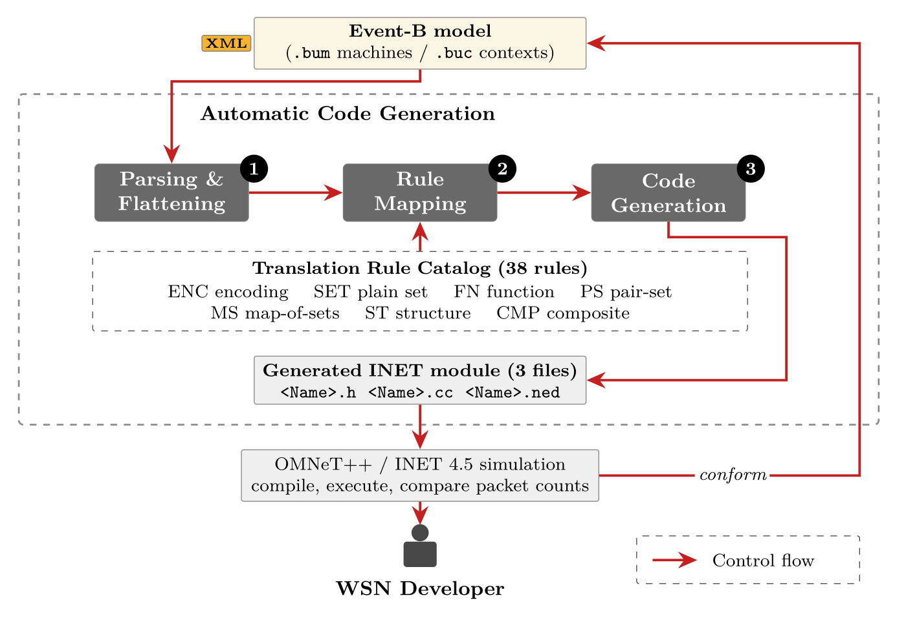

# Documentation

How WSN-CodeGen turns a Rodin project into an OMNeT++/INET module. The paper gives the short
form of each step because of its length limit; this page gives the longer form, and covers the
network layer, which the paper does not reach. For the rules themselves see
[Translation rules](TRANSLATION_RULES.md); for running the tool see [Usage](usage.md); for the
protocol case studies see [Case studies](case-studies/index.md).

| Paper (Section 2) | Expanded here |
|---|---|
| 2.1 Framework, the three steps | section 1 |
| 2.2 Step 1, Parsing and Flattening | section 2 |
| 2.3 Step 2, Rule Mapping (encoding, translation rules) | sections 3 and 4 |
| 2.4 Step 3, Code Generation (INET model, emission) | section 5 |
| not in the paper: the network layer | sections 6, 7 and 8 |

---

## 1. The pipeline

*Figure 1 of the paper.*

| # | Step | Engine modules | Responsibility |
|---|---|---|---|
| 1 | Parsing and Flattening | `parser.ts`, `flattener.ts` | read the Rodin XML from its authoritative attributes; compute refinement depth, find the most-refined machine and flatten the chain into one model |
| 2 | Rule Mapping | `encodingResolver.ts`; `rules.ts` and the network rule files; `ruleEngine.ts` | give every state variable a C++ storage form, from its type *and* its usage; apply the catalog clause by clause, so an unmatched clause becomes `// UNTRANSLATED` |
| 3 | Code Generation | `codeEmitter.ts` | assemble the state, the methods, the simulator shell and the `.ned` |

In the code, steps 2 and 3 are interleaved: the emitter calls the rule engine clause by clause
as it assembles the module. The paper counts them as steps because that is how their cost
behaves; the code does not run them one after the other.

**Why one module and not one per machine.** The most-refined machine, flattened over its chain,
already subsumes the state and events of every abstraction level. Generating from it yields a
single compilable class, which is what the simulator wants: an INET module is one C++ class,
not a chain of them. The flattener is name-agnostic. Any `pM1 → uM2 → pM3` style chain works,
and the entry point is discovered from the files, not configured.

---

## 2. Input: the Rodin project

The input is a Rodin project directory: one `.bum` per machine, one `.buc` per context, both
XML, exactly as Rodin writes them. No annotation is added to the model.

| XML element | Attribute read | What it becomes |
|---|---|---|
| `machineFile` | none | one translation unit; the most-refined machine becomes the module |
| `refinesMachine` | `target` | the refinement edge, from which the chain and its depth are computed |
| `seesContext` | `target` | the context whose axioms supply carrier sets and constants |
| `variable` | `identifier` | a member of the generated class |
| `invariant` | `predicate` | the variable's **type**, and hence its storage form |
| `event` | `label` | one guarded `bool` method, named after the label |
| `parameter` | `identifier` | a method parameter, typed from its typing guard |
| `guard` | `predicate` | an early `return false` test, one per guard |
| `action` | `assignment` | a statement in the method body, in declared order |

Two properties of that structure decide the whole translation.

**A variable's type is not on the variable.** The `variable` element carries only an identifier;
the type is stated separately as an invariant over it. Reading `pktFwdr`'s container means
finding `pktFwdr ∈ PKT ⇸ ND` and interpreting it, which is why encoding selection is a stage
and not a lookup.

**Predicates come from the authoritative attributes**, `org.eventb.core.predicate` and
`org.eventb.core.assignment`, not from the `text_representation` rendering Rodin also stores.
That rendering is a cache and can be stale.

> **The override glyph.** Because the authoritative attributes are used, relational override
> arrives as the private-use codepoint **U+E103**, not as a printable `⩤`-style character. A
> parser matching the printable glyph drops those actions silently. If you extend the rule set,
> match U+E103.

**What the input must contain for each structure.** Structures 1 and 2 need only the
application-layer chain. Structure 3 needs the CommPattern state the bundled extension builds on
(`createdPkts`, `pktFwdr`, `pktData`, `ndBuff` and `sentUp`); a project without it is refused
with a message that points to structure 2. Structure 4 also needs the project's contexts to
declare a split of the control packet type. The `tests/fixtures/shdecom` fixture generates
structures 1 to 3 and is refused by structure 4 for that reason.

---

## 3. Encoding selection

The C++ form of an operator depends on how its variable is stored: `x ∈ S` is
`S.count(x) > 0` for a plain set, but `a ↦ b ∈ R` is `R.count({a,b}) > 0` for a set of pairs,
and different again for a map of sets. Six rules decide, by type **and** observed usage, never
by the variable's name.

| ID | Event-B type / usage | C++ container |
|---|---|---|
| ENC1 | element of a carrier set used by identity, or of a constrained integer set | `int`, aliased `Node`, `PktId`, `Data` |
| ENC2 | `S ⊆ T` or `ℙ(T)` | `std::set<T>` |
| ENC3 | `f ∈ A → B` or `A ⇸ B` | `std::map<A,B>` |
| ENC4 | `R ∈ A ↔ B` used only by whole pairs, never indexed | `std::set<std::pair<A,B>>` |
| ENC5 | `M ∈ A → ℙ(B)`, or a relation accessed per key | `std::map<A,std::set<B>>` |
| ENC6 | `BOOL`, or a finite tag carrier set | `bool`; `enum class` |

**ENC4 versus ENC5 is the one that matters in practice.** Both apply to relations, and the type
declaration alone does not separate them. Only the usage does. A buffer that is only ever tested
and updated by whole pairs is exactly a set of pairs. A neighbour table whose value-set is added
to and removed from per packet is exactly a map of sets; storing it as a set of pairs would
force a linear scan on every access.

**Packet attributes are a special case (ENC7).** Event-B keeps packet attributes as a family of
functions keyed by packet id; C++ wants fields on one chunk. The packet encoding moves each
attribute onto the `PPkt` chunk and the rules for it follow from that choice. A partial
attribute also needs to know which packets it is defined for, and that domain is separate state
per field, so each partial field gets its own liveness set. ENC7 is the source of the one defect
class that recurred: a value kept in two places, one that the model writes and one that a guard
reads.

**Two more encodings serve the network layer.** A pair-keyed function (`lastSeqno ∈
neighbourTbl → ℕ`, a function of a pair) is declared with a pair as its key, not with a single
node. A two-level table (`nbHops ∈ ND ↔ (PKT ⇸ ℤ)`) keeps both levels, where a flat map would
drop the inner function. Both are chosen by `pairKeyed.ts` and `nestedMap.ts`.

---

## 4. Translation

Each guard and each action is one clause. `translateEvent` tries every rule once per clause, in
order, and takes the first that matches.

- **Typing guards are dropped** (`x ∈ ND ∧ pkt ∈ PKT`): the C++ types already enforce them. A
  guard that names a subset the context only restricts (`nb ∈ Dests`) is not a typing guard and
  is kept.
- **Guards become early returns**, in declared order, then the actions follow.
- **An unmatched clause becomes `// UNTRANSLATED`.** It does not disappear, which is what makes
  the rule gap a figure you can read off the output.
- **An event with any unmatched clause refuses to fire.** It is closed with `return false` and
  a comment saying why, because returning `true` would report a transition that did not fully
  happen.
- **Membership in a set expression is pushed to the leaves.** `x ∈ A ∪ B` is translated as a
  test on `A` or on `B`. `ran` and `dom` distribute over `∪` but not over `∖` or `∩`, so those
  are refused: translating them would give a wrong answer.
- **A function application is guarded by its domain.** An Event-B guard is an unordered
  conjunction, so `f(k) = v` may be written before `k ∈ dom(f)`. The emitter turns guards into a
  sequence, and an unchecked `map::at` would throw before the domain test is reached. The
  function-application rules therefore test the domain first.

> **A nested relational form is still out of reach.** `MS6` translates `ran({k} ◁ M)` for a
> stored variable `M`, but not the two-level `ran({nIdx} ◁ ran({pkt} ◁ dsrPath))`. That is the
> DSR reverse-path guard; the [DSR page](case-studies/dsr.md) records what supporting it would
> need.

See [Translation rules](TRANSLATION_RULES.md) for all 38, and [Rule map](rule-map.md) for which
source rule implements which.

> **The two numberings differ.** The catalog has 38 rules; `src/engine/rules.ts` has **25**
> matcher entries, and their ids are not the catalog's names. One matcher can realise several
> catalog rules (`UNION-pair` matches `R ≔ R ∪ {a ↦ b}` and dispatches on the container, so it
> is `PS2` for a pair-set, `FN3` for a function, `MS2` for a map-of-sets), and one catalog rule
> can need several matchers. `ENC1` to `ENC6` and `ST1` to `ST5` are not in that file at all:
> the first six choose containers in `encodingResolver.ts`, the last five are structural and
> applied by `codeEmitter.ts`. The network layer adds its own rule files (packet fields,
> pair-keyed functions, two-level tables, relational image, scalar constants).
> [Rule map](rule-map.md) is generated from the rule source so it cannot drift.

---

## 5. Output: the three-file contract

| File | What is in it |
|---|---|
| `<Name>.h` | class declaration, state members in their chosen containers, the inlined Event-B context (carrier sets and constants taken from the `.buc` axioms), and the helper templates the rules emit calls to |
| `<Name>.cc` | one guarded `bool` method per event; `INITIALISATION` becomes the constructor; plus the simulator-facing shell |
| `<Name>.ned` | a simple module bound by `@class`, with the parameters, gates and signals the shell uses; for structures 3 and 4, also the `<Name>NetworkLayer` wrapper |

The module is named `EbWsn` for every structure. The web page has a name field and the
programming interface takes a name; the command line does not. The generated code sits in a C++
namespace derived from the name (`eb_ebwsn`), so two differently named generated modules can be
linked into one executable. Two modules with the default name share a namespace, class and NED
type, so linking two of them needs an explicit name for one.

The header is self-contained on purpose: structure 1 still `#include`s two fixture headers
(`eb_context.h`, `eb_helpers.h`) that only the command-line interface stages, and a module
downloaded from the web app referenced files that were not there. From structure 2 onward
everything the module needs is inside the three files.

---

## 6. The four structures

| Flag | Structure | Shell | Files | What it adds |
|---|---|---|---|---|
| `--v1` | 1 | `ApplicationBase`, shaped like INET's `SensorApp` | 5 (the three plus the two fixture headers) | the paper's V1. It compiles and runs, and transmits nothing: the transmit call sits behind an unbound extension point |
| `--v2` (default) | 2 | the same | 3 | the paper's V2. The transmit is bound, the context is inlined, the counters and log strings match `SensorApp` |
| `--v3` | 3 | `NetworkProtocolBase` + `INetworkProtocol`, shaped like INET's `MintRoute` | 3 | the bundled pattern extension: `PPkt` packet classes and the `PRouteTable` neighbour table, the flooding scheduler, the per-type send methods |
| `--v4` | 4 | the same | 3 | structure 3 plus the next-hop design (section 8) |

`--routing flooding|aodv|dsr` chooses which control-packet split the pattern extension applies
in structures 3 and 4; it is refused anywhere else, and `dsr` is structure 4 only. The web app
takes no routing option and emits structure 3 from the project's own shape.

### The application layer (structures 1 and 2)

The generated class derives from INET's `ApplicationBase` and is shaped like INET's own
`SensorApp`: a dispatcher in `handleMessageWhenUp`, a sensing timer, socket lifecycle handlers.
Where the model supplies the communication pattern pair, those two events are emitted under
`SensorApp`'s names. Event-B `send_down` becomes `bool sendSensorPacket(Node, PktId)` and
`send_up` becomes `bool socketDataArrived(Node, PktId, set<Node>)`, each carrying an
`// Event-B: <label>` provenance comment. Every other event keeps its Event-B name.

### The network layer (structures 3 and 4)

The module sits directly above the MAC, as INET's `MintRoute` does, so there is no IPv4 layer in
between. Packets arrive at `handleLowerPacket` and leave through `sendDown`. The thesis pairs
`sendDown()` with `handleLowerMsg()`, and the generated code pairs `sendDown` with
`handleLowerPacket`.

What the model decides and what the simulator decides:

- **The model decides** which packets exist, who may originate one, what a receiver does with
  it, and what is recorded in the neighbour table.
- **The simulator decides** who is in range. The model's send-down and send-up events are
  realised by the radio, not scheduled inside the module. If they were scheduled, the sending
  node would compute its own neighbours and deliver the packet to itself.

The generated module has one class per node, where the Event-B model describes the whole
network as one state space. That difference is the reason for the node identity and arrival
bindings, and it is why a few model variables (the medium itself, the topology
relation) are realised by the simulator and not stored.

---

## 7. Generated and hand-written

The line follows the project's four-by-four class matrix. A node's behaviour splits into what
every WSN protocol shares and what one protocol decides.

| Generated | Hand-written (the Specific layer) |
|---|---|
| sensing, packet creation, buffering, send and receive | parent selection and link cost (MintRoute) |
| the packet type classes (`PPkt`) | route discovery, reply and error handling (AODV) |
| the neighbour table and its per-link counters | path accumulation and the route cache (DSR) |
| the flooding of control packets, with duplicate suppression | the route fields carried in a protocol's packets |
| the route-table operation `addEntry` and route publication (structure 4) | which route a node chooses |

The hand-written part is written as **test code**, pasted into the generated module. Three
conventions keep it separate from the generator:

- **It is marked.** Every pasted line carries `[MintRoute test code]`, `[AODV test code]` or
  `[DSR test code]`.
- **It is switched.** A boolean NED parameter (`mintRoute`, `aodv`, `dsr`) turns the test code
  on. With it off, the module is the generated one.
- **It stays out of the generator.** The generator's output is the same with or without it.

A forgotten paste is silent: the unedited module runs, ends at a recognisably different event
count, and records no result scalars. Each case study's page says which scalar to look for.
Support code for measurement (the tree drawing, the node-failure switch, the result scalars) is
test code too, in marked blocks that can be left out without changing the protocol.

---

## 8. What structure 4 adds

Structure 4 is structure 3 plus the pieces a route needs. Each one is read off the model or
taken from the baseline's own names; none is configured.

- **Route-table operations.** `PRouteTable` is the whole route table: the neighbour table and
  the route entries. One operation, `addEntry`, creates or updates an entry, and it is called by
  a protocol's code, never scheduled by the module.
- **A packet next hop.** A data packet can carry a next hop. The transmit sends it as a MAC
  unicast to that address when one is set, and as a broadcast otherwise.
- **Route publication.** Entries are published into INET's routing table: one-hop routes for
  neighbours, and the route entries for destinations reached through them.
- **One timer per control packet type**, each armed on every node, in the shape of INET
  `MintRoute`'s `handleSelfMessage`.
- **Baseline names.** Where a generated event does the job of a baseline function, it is emitted
  under the baseline's name (`onReceiveBeaconPkt`, `updateNbrCounters` for MintRoute;
  `startRouteDiscovery`, `sendRREQ`, `handleRREQ`, `createRREQ` for AODV; `sendRREQ` for DSR),
  with the Event-B label kept as a comment.

Two known gaps are recorded rather than hidden. The model's data path (`create_dataPkt`) has no
binding for the sensed value, which is the environment's, so no case study sends DATA. And a
scalar assignment inside an event (`v ≔ TRUE`) has no rule yet; only the initialisation is
handled, by the member initialiser.

---

## 9. Checks that come with the output

| Check | What it shows |
|---|---|
| `clang -fsyntax-only` against INET 4.5 | the three files compile with nothing else present |
| the test suite | runs on every push; the part that reads the advisor's models is skipped on a checkout that lacks them, and the rest still runs |
| `npm run check:output` | regenerates every output and compares it byte for byte with a saved reference, so a refactor that moves a generated byte is caught |

---

## 10. Downloads and reference

**Downloads.** Built from the repository's own application-layer fixture each time the site is
built, so they match the current generator.

| File | What it is |
|---|---|
| [shdecom-project.zip](downloads/shdecom-project.zip) | the input: three machines (`pM1`, `uM2`, `pM3`) and one context, as Rodin writes them |
| [shdecom-generated-structure2.zip](downloads/shdecom-generated-structure2.zip) | `EbWsn.h`, `EbWsn.cc`, `EbWsn.ned` from `--v2` |
| [shdecom-generated-structure3.zip](downloads/shdecom-generated-structure3.zip) | the same three files from `--v3`, the network-layer module the web page emits |

**Reference.**

| Page | What it holds |
|---|---|
| [Translation rules](TRANSLATION_RULES.md) | all 38 rules: the Event-B shape, the C++ produced, the storage form assumed, the evidence |
| [Rule map](rule-map.md) | which source rule implements which catalog rule |
| [Interface mapping](INTERFACE_MAPPING.md) | the per-interface Event-B to C++ mapping the catalog was induced from |
| [Findings](findings/netlayer/README.md) | the dated studies and defect reports behind the network-layer work |
