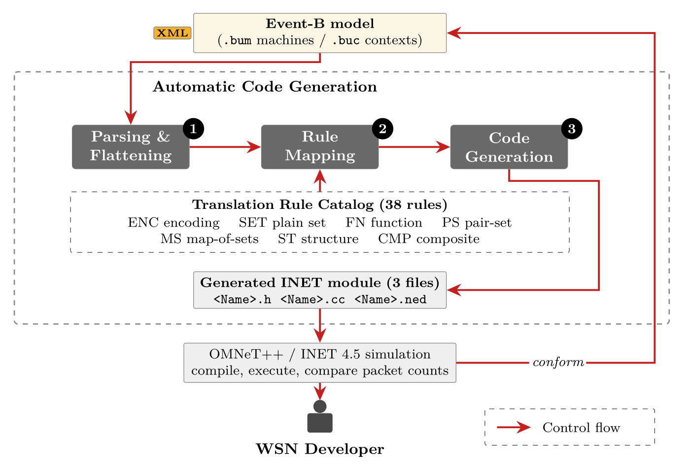
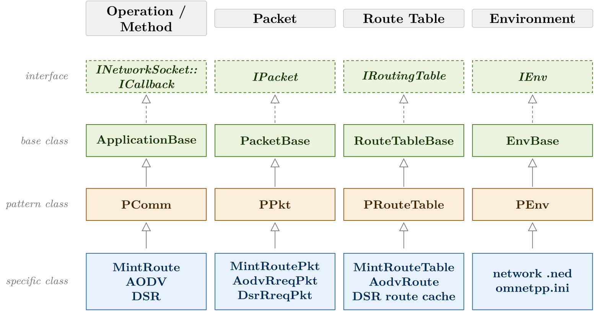

# WSN-CodeGen

**Automatic code generation from pattern-based Event-B models for wireless sensor networks.**

WSN-CodeGen is a free web application that translates a Rodin Event-B project into a
compilable OMNeT++/INET module. It runs entirely in the browser: the model is parsed and the
code generated on your own machine, and nothing is uploaded to a server.

- **Tool:** <https://komenpetch.github.io/wsn-codegen/>
- **Source:** <https://github.com/komenpetch/wsn-codegen> (MIT licence)
- **Version:** the tool and these pages are built from the `main` branch of the repository.
  The footer of every page names the commit it was built from.

The paper describes the application layer in detail. These pages hold what the paper has no
room for: the network layer, the three protocol case studies, the run configurations and the
measured results.

*An overview of the framework (Figure 1 of the paper).*

---

## Highlights

- **One project in, one module out.** Give it a Rodin project (the `.bum` machines and `.buc`
  contexts as Rodin writes them, with no annotation added) and it returns three
  self-contained files, `EbWsn.h`, `EbWsn.cc` and `EbWsn.ned`, that drop into an OMNeT++/INET 4.5
  simulation. The generated `.cc` compiles against real INET 4.5 headers with only those three
  files present.
- **Set-theoretic guards are translated, not simplified by hand.** Relational image, domain
  restriction and membership over relations are covered by a [38-rule catalog](TRANSLATION_RULES.md)
  induced from the WSN event component patterns themselves, not enumerated from the Event-B
  language.
- **The whole refinement chain becomes one module.** The most-refined machine, flattened over
  its ancestors, carries every level's state and events, which matches how the simulator
  consumes the result: an INET module is one C++ class.
- **Containers are chosen, not assumed.** Every state variable gets a C++ storage form from its
  Event-B type and its observed usage.
- **Nothing is dropped silently.** A clause no rule matches is emitted as an explicit
  `// UNTRANSLATED` comment, and the event it belongs to refuses to fire.
- **Each result comes with a run.** Every similarity figure is paired with a simulation that
  checks the module's behaviour, because a module can compile, run and still do nothing.

## What is generated and what is not

The generated part is the common part of a WSN node: sensing, packet creation, the neighbour
and destination buffers, the send and receive path, the packet type classes (`PPkt`) and the
neighbour table (`PRouteTable`). The protocol-specific part is hand-written. MintRoute's parent
selection, AODV's route discovery and DSR's path handling are test code, pasted into the
generated module and marked line by line.

*The class architecture (Figure 11 of the paper, with its fourth level added). Each group has an interface and a base class, which are INET's or common to all protocols (green), a pattern class, which is generated (amber), and a specific class, which a particular protocol fills in by hand (blue). The paper leaves the fourth level undrawn because it reports one case study. The [case studies](case-studies/index.md) here are that level: MintRoute, AODV and DSR, each with its own packet fields and route data, and the network file and `omnetpp.ini` of the harness. Each says exactly where the line falls for its protocol.*

## Try it

1. Download the example project, [shdecom-project.zip](downloads/shdecom-project.zip): the
   application-layer chain of the pattern, three machines and one context, from the
   repository's own test fixture.
2. Open the [tool](https://komenpetch.github.io/wsn-codegen/), choose **or load a .zip**, and
   pick the file.
3. Press **Generate → save**. Three files arrive. The tool emits structure 3, the network-layer
   module.

To see the same result without running anything, the generated files are here:
[structure 2](downloads/shdecom-generated-structure2.zip) (the application module, the
default of the command line) and
[structure 3](downloads/shdecom-generated-structure3.zip) (the network-layer module).
[Usage](usage.md) covers the command line and putting the module into OMNeT++.

## Where to go next

| Page | For |
|---|---|
| [Documentation](documentation.md) | how the framework works in full: the pipeline, the input format, encoding and translation, the output contract, the four emitted structures |
| [Case studies](case-studies/index.md) | SensorApp, MintRoute, AODV and DSR: what is generated, what is pasted, how to run it, what was measured |
| [Usage](usage.md) | running the tool in the browser and from the command line, and putting the module into OMNeT++ |
| [Translation rules](TRANSLATION_RULES.md) | the complete 38-rule catalog, with the Event-B shape and the C++ each rule produces |
| [Rule map](rule-map.md) | which source rule implements which catalog rule |
| [Interface mapping](INTERFACE_MAPPING.md) | the per-interface Event-B to C++ mapping the catalog was induced from |
| [About](about.md) | the project, the people, availability, and how to cite it |
| [Harness](harness/README.md) | the simulation harnesses every measured number came from |
| [Findings](findings/netlayer/README.md) | the dated studies and defect reports behind the network-layer work |
